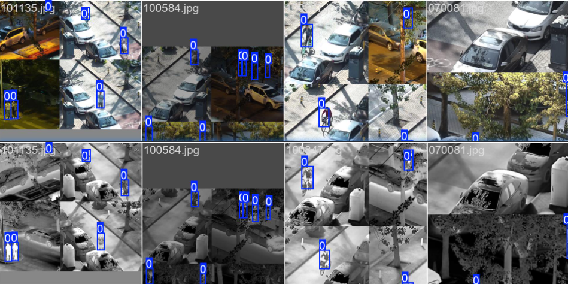
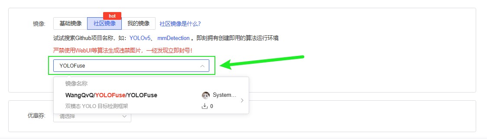
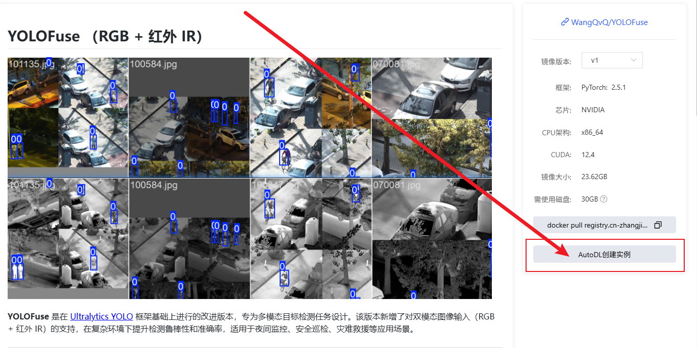

<p align="center"><a href="README_en.md">English</a></p>


<p align="center">
  <a href="https://github.com/WangQvQ/YOLOFuse/releases">
    
  </a>
  <a href="https://github.com/WangQvQ/YOLOFuse">
    
  </a>
  <a href="https://github.com/WangQvQ/YOLOFuse">
    
  </a>
  <a href="https://github.com/WangQvQ/YOLOFuse/blob/main/LICENSE">
    
  </a>
  <a href="https://github.com/WangQvQ/YOLOFuse">
    
  </a>
  <a href="https://www.codewithgpu.com/i/WangQvQ/YOLOFuse/YOLOFuse">
    
  </a>
</p>


# YOLOFuse v1.0.0：面向多模态目标检测的双流融合框架

<p align="center">
  
</p>

**YOLOFuse** 是基于 [Ultralytics YOLO](https://github.com/ultralytics/ultralytics) 框架构建的增强型目标检测系统，专为多模态感知任务设计。本框架创新性地引入双流处理架构，支持RGB与红外（IR）图像的协同分析与特征融合，显著提升复杂环境（低照度、烟雾遮挡、极端天气等）下的检测鲁棒性。适用于安防监控、灾害救援、工业巡检等关键场景。

---

## 📋 更新日志

### v1.0.0 (2025-05-17)

- 新增 DEFA（动态增强融合注意力）融合策略
- 修复 IR 路径替换鲁莽问题（只替换目录级 `images`）
- 修复 `cache="disk"` 双模态模式下失效的问题
- 修复 IR 图像缺失时训练直接崩溃的问题（自动 fallback）
- 修复 RGB/IR 图像尺寸不匹配时的处理（自动 resize）
- 修复 `ModalConcat` 对嵌套输入的处理
- 修复 `get_flops` 双模态模型计算错误
- 恢复默认 `ch=3`，保持单模态向后兼容
- 添加 `tests/test_fuse_models.py` 测试套件（31 个测试用例）
- 添加 `einops` 依赖声明

---

## ✨ 技术特性

* 🚀 **异构数据融合**：实现RGB与IR图像（可扩展至RGB-D等模态）的端到端联合处理
* 🔧 **兼容YOLOv8 API**：保留原生接口规范，确保用户迁移成本最小化
* 🔍 **可扩展融合模块**：提供多层次融合策略，支持：
  - ✅ 数据级融合（Data-level Fusion）
  - ✅ 决策级融合（Decision-level Fusion）
  - ✅ 早期特征融合（Early-level Feature Fusion）
  - ✅ 中期特征融合（Mid-level Feature Fusion）
  - ✅ 极简融合（Easy-level Feature Fusion）
  - ✅ DEYOLO（[arxiv](https://arxiv.org/abs/2412.04931)）
  - ✅ DEFA（动态增强融合注意力）

---

## 📊 LLVIP基准测试结果

<p align="center">


| 模型架构               | 模态     | 精度 (P) | 召回率 (R) | mAP\@50 | mAP\@50:95 | 模型大小 (MB) | 计算量 (GFLOPs) |
| ------------------ | ------ | ------ | ------- | ------- | ---------- | --------- | ------------ |
| YOLOv8n (baseline) | RGB    | 0.888  | 0.829   | 0.891   | 0.500      | 6.20      | 8.1          |
| YOLO-Fuse-中期特征融合   | RGB+IR | 0.951  | 0.881   | 0.947   | 0.601      | 2.61      | 3.2          |
| YOLO-Fuse-早期特征融合   | RGB+IR | 0.950  | 0.896   | 0.955   | 0.623      | 5.20      | 6.7          |
| YOLO-Fuse-决策级融合    | RGB+IR | 0.956  | 0.905   | 0.955   | 0.612      | 8.80      | 10.7         |
| YOLO-Fuse-极简融合     | RGB+IR | 0.899  | 0.865   | 0.939   | 0.620      | 7.83      | 8.5          |
| DEYOLO             | RGB+IR | 0.943  | 0.895   | 0.952   | 0.615      | 11.85     | 16.6         |


---

## 🧩 数据输入规范

系统通过文件名自动关联异构数据源，需确保文件命名一致性：

```
数据集目录/
├── images/        # RGB图像
│   └── 120270.jpg 
└── imagesIR/      # 红外图像（同级目录）
    └── 120270.jpg  # 同名IR文件
```

> 标注文件仅需基于RGB图像生成，系统自动复用至IR模态

---

## 🚀 快速部署指南

### 1️⃣ 环境初始化

```bash
git clone https://github.com/WangQvQ/YOLOFuse.git
cd YOLOFuse
pip install -e .  # 可编辑模式安装
```

### 2️⃣ 模型训练

```bash
python train_dual.py  # 启动双流训练
```

### 3️⃣ 推理验证

```bash
python infer_dual.py  # 执行融合推理
```

### 单模态可见光训练

单模态可见光仍为 RGB 三通道。需要同时选择标准单流模型和 `ch=3`；融合 YAML 不能仅靠修改 `ch` 切换成单流。

```python
from ultralytics import YOLO

model = YOLO("yolov8n.yaml")
model.train(data="ultralytics/cfg/datasets/LLVIP.yaml", ch=3)
```

### 模型导出

```bash
python export_dual.py
```

```python
from ultralytics import YOLO

model = YOLO("runs/train/easy-fuse/weights/best.pt")
model.export(format="onnx", imgsz=640, opset=17, simplify=True)
# model.export(format="torchscript", imgsz=640)

exported = YOLO("runs/train/easy-fuse/weights/best.onnx", task="detect")
results = exported.predict(source="/path/to/LLVIP/images/test", imgsz=640)
```

- 导出输入通道由模型结构决定，保存在导出元数据中；推理和独立验证会自动读取，无需再传 `ch=6`。
- 输入文件按 `images` → `imagesIR` 目录配对；数组为 HWC `[RGB的BGR三通道, IR的BGR三通道]`，浮点张量为 BCHW `[RGB, IR]`，归一化到 0–1。空间增强对两个模态同步应用。
- 新训练模型与推理统一采用 `[RGB, IR]` 顺序；原仓库训练流程曾整体反转六个通道。旧 `.pt` 权重缺少 `input_order` 标记时会在模型内部自动交换模态，保持原有权重语义。自行修正过顺序的旧权重请显式设置 `model.model.yaml["input_order"] = "rgb_ir"`。
- `predict()` 返回标准 `list[Results]`，对应可见光图片；红外预览保存在 `model.predictor.ir_results`，`save=True` 时分别保存 `_rgb` / `_ir` 图片。
- 双模态磁盘缓存使用 `.rgbir.npy`，与单模态 `.npy` 分开。RGB/IR 图像必须已配准，自动缩放只解决尺寸差异，不会完成空间配准。
- 验证覆盖七种融合模型的 TorchScript、静态/动态 ONNX。CoreML 当前使用 RGB ImageType，六通道会明确报错；TensorRT、OpenVINO、TensorFlow、NCNN 等后端尚未在本次环境实测，不能据此认为所有格式均可用。双模态视频流需要外部同步组装六通道帧，不会自动配对视频。

回归测试（ONNX 相关测试需要 `pip install onnx onnxruntime onnxslim`）：

```bash
python -m pytest tests/test_fuse_models.py tests/test_fuse_pipeline.py -q
```

> 预训练权重下载：
> 链接：[https://pan.quark.cn/s/ec13c6e17b8d]([https://](https://pan.quark.cn/s/ec13c6e17b8d))
> 提取码：HETx

---

## 📂 数据集结构

采用标准YOLO格式，目录结构示例如下：

```
datasets/
├── images/
│   ├── train/    # RGB训练集
│   └── val/      # RGB验证集
├── imagesIR/     # IR图像集（与images目录同级）
│   ├── train/
│   └── val/
└── labels/       # 统一标注文件
    ├── train/
    └── val/
```

---

## ⚡ AutoDL云端部署方案

[[Open in AutoDL]](https://www.codewithgpu.com/i/WangQvQ/YOLOFuse/YOLOFuse)

<p align="center">
   
</p>

<p align="center">
  
</p>

```bash
conda activate Ultralytics-RGB-IR
cd YOLOFuse

# 训练执行
python train_dual.py

# 推理验证
python infer_dual.py
```
